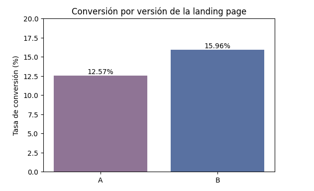

# Experimento A/B en una landing page: Conversión, gasto y fuentes de tráfico

Caso de negocio simulado del bootcamp de Data Analytics de TripleTen. Los datos son ficticios.

## Pregunta de negocio
¿Qué versión de la página de inicio rinde mejor y qué fuentes de tráfico y tipos de usuario convierten más?

## Datos
40,000 usuarios (19,982 en la página A y 20,018 en la B), del 1 al 28 de enero de 2026. Variables: región, dispositivo, fuente de tráfico, tipo de usuario, conversión y gasto. Sin valores nulos.

## Qué hice
1. Exploración y validación de los datos.
2. Gasto promedio de los usuarios convertidos: prueba de Levene y Welch T-Test.
3. Tasa de conversión: prueba z de proporciones.
4. Fuente de tráfico y conversión: Chi-cuadrado.
5. Tipo de usuario y conversión: Chi-cuadrado.
6. Visualizaciones y resumen ejecutivo.

## Hallazgos

*Tasa de conversión por fuente de tráfico.*

| Pregunta | Prueba | Resultado |
|---|---|---|
| ¿Cambia el gasto de quienes convierten? | Welch | Sí (t = −9.48, p < 0.001): gasta más la página B |
| ¿Cambia la conversión? | z de proporciones | Sí: 12.57% vs 15.96% (+3.4 puntos; z = −9.68, p < 0.001) |
| ¿Influye la fuente de tráfico? | Chi-cuadrado | Sí, aunque con diferencias pequeñas (p = 0.034): Email 14.99%, Ads 14.74%, Referral 13.88%, Organic 13.79% |
| ¿Influye el tipo de usuario? | Chi-cuadrado | No (p = 0.474): Nuevo 14.36%, Recurrente 14.09% |

Organic aporta el mayor volumen de conversiones (2,480) porque concentra más usuarios, no porque sea la fuente más efectiva.

## Recomendaciones
- Adoptar la página B como versión de referencia y seguir monitoreándola.
- Mantener Organic por su volumen y explorar el escalamiento de Email por su tasa de conversión, evaluando antes el costo de adquisición de cada fuente.
- No diferenciar estrategias por tipo de usuario con estos datos.

## Herramientas
Python (pandas, NumPy, SciPy, statsmodels, seaborn, Matplotlib)

## Contenido
- `landing-ab-test.ipynb`: análisis completo.

## Nota
Los datos pertenecen al bootcamp y no se incluyen en este repositorio.
